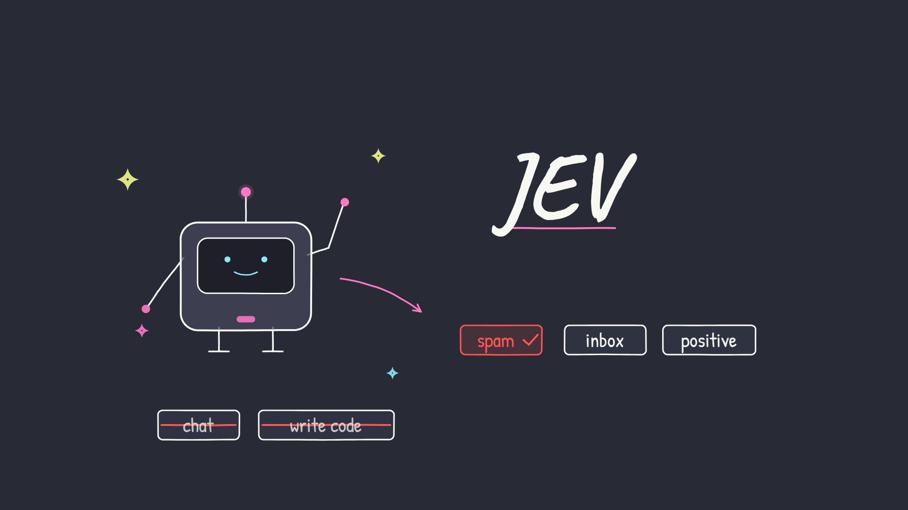

# Jev — a minimalist AI explainer

A 13:14 hand-drawn explainer about **Jev**, a model that only sorts text.  
Made with [Remotion](https://remotion.dev), rough SVG linework, the Dracula palette, Caveat + Patrick Hand, and word-level Whisper timestamps.



## Watch it

**Local preview (no render):**

```bash
cd video
npm install
npx remotion studio --port 3000
```

Open **http://localhost:3000** and choose `Jev`. The 1080p master is 1920×1080 at 30 fps.

**Render the full 2K (2560×1440) version on Google Colab:**

[](https://colab.research.google.com/github/lroe/jev/blob/main/colab/render_2k.ipynb)

The notebook:

1. **Requests Google Drive access first** with `drive.mount()`. Nothing is installed or rendered until you approve.
2. Clones this repo and installs Node 22 + the pinned Remotion stack.
3. Renders at **2560×1440** (true 2K; the 1080p master is rendered at 1.333×).
4. Prints **live progress, frame counts, and ETA** in the cell output.
5. Saves the MP4 and a render log to **`MyDrive/jev_render/`** by default. Change `DRIVE_DIR` in the first cell to use another folder.

2K is CPU-bound. Expect several hours on a free Colab CPU runtime; more CPUs (Colab Pro) help. A GPU does not speed up Remotion.

> Private repo? Add a Colab secret named `GITHUB_TOKEN` with read access before running the clone cell. The notebook never stores a token.

## What's inside

```
video/                 Remotion project (54 scenes, 23820 frames)
  src/scenes/          part1–part4: all scenes
  src/words.ts         Whisper word-level timestamps
  src/timing.ts        at() / scoped() lookups
  public/audio.wav     narration
  scripts/render_2k.mjs
colab/render_2k.ipynb  2K Google Colab renderer
work/                  Whisper transcript + sentence alignment
docs/preview.png       a still from the video
skill.md               visual/timing spec
Narration (TTS ready).md
```

## How the sync works

Every visual reveal calls `at("spoken phrase")` or a scene-scoped `A("phrase")`. That returns the exact Whisper timestamp; Remotion converts it to a frame. Labels, arrows, values, and figures draw on the word that introduces them.

Scene changes are hard cuts with each scene's first visual pre-rolled, so the canvas is never blank between scenes.

## Local 2K render

```bash
cd video
npm ci
REMOTION_BROWSER_EXECUTABLE=/usr/bin/google-chrome \
  node scripts/render_2k.mjs --output out/jev_2k.mp4 --scale 1.3333333
```

The script uses `@remotion/renderer` directly and prints progress every update. `--frames 0-149` renders a 5-second check.
